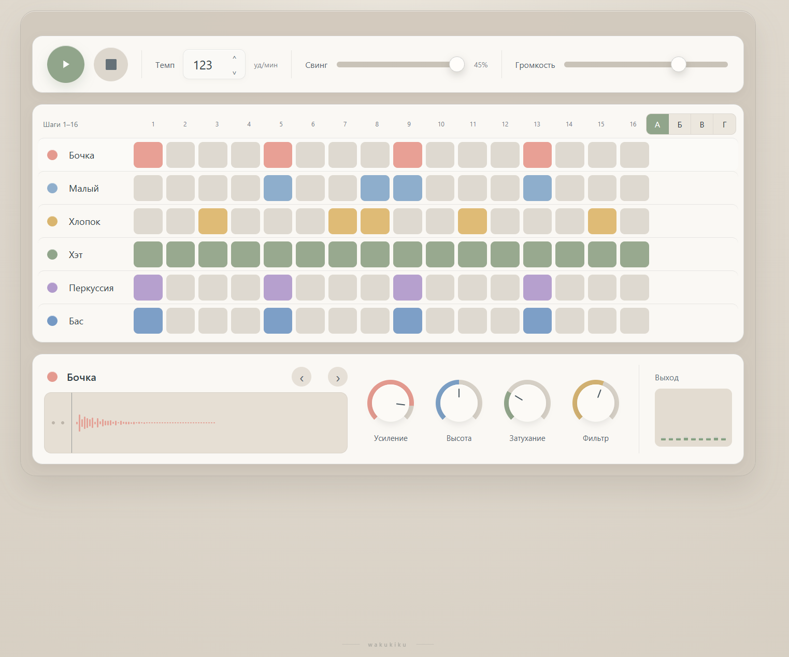

# drmachine

Минималистичная браузерная драм-машина на Vue 3 с 16-шаговым секвенсором и Web Audio.

Приложение позволяет собирать ритмы прямо в браузере: включать шаги секвенсора, переключать паттерны, менять темп, свинг, громкость и параметры отдельных инструментов.

### [Открыть демо →](https://drmachine.vercel.app/)

## Превью

### Desktop



## Возможности

- 16-шаговый секвенсор;
- 6 инструментов:
  - бочка;
  - малый;
  - хлопок;
  - хэт;
  - перкуссия;
  - бас;
- 4 независимых паттерна;
- воспроизведение и остановка;
- ручной ввод BPM;
- изменение BPM колесом мыши;
- настройка свинга;
- мастер-громкость;
- отдельные параметры каждого инструмента:
  - усиление;
  - высота;
  - затухание;
  - фильтр;
- визуализация формы сигнала;
- индикатор выхода;
- плавные анимации шагов и контролов;
- сохранение состояния в браузере;
- Web Audio без внешних аудиофайлов;
- адаптивный интерфейс;
- авторская метка `wakukiku`.

## Стек

- Vue 3
- Vite
- JavaScript
- CSS
- Web Audio API
- LocalStorage

## Запуск локально

```bash
git clone https://github.com/wakukiku/drmachine.git
cd drmachine
npm install
npm run dev
```
